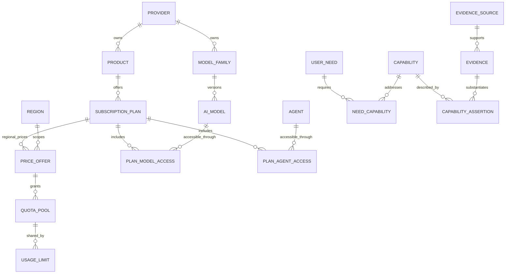

# AI Compass — архитектура P01/P02

## Граница

Модульный монолит: React/TypeScript → same-origin Vite proxy → Java/Spring Boot → PostgreSQL. В P01 Docker Compose управляет локальной БД; frontend и backend работают на хосте с закреплёнными инструментами. В P02 добавлены схема и внутренний импорт каталога. Production images/Caddy, публичное catalog API, аккаунты и Recommendation Engine ещё не реализованы. Их границы остаются по CODEX_PROMPT.md.

Неизменённая миграция V1 создаёт схему `compass`; V2 добавляет каталог, V3 — защиту снимков. Служебная таблица Flyway ведёт историю миграций. Hibernate использует `validate`; `open-in-view` отключён. Пустая БД не получает демонстрационные тарифы.

Readiness включает DB health, но наружу отдаёт только `status`. `/actuator/env` закрыт. CSRF не отключён; HTTP-ошибки API используют Problem Details. Только чтение scaffold API и health разрешено анонимно; аккаунты пока отсутствуют.

## Закреплённые версии

| Компонент | Версия |
|---|---|
| Temurin JDK | 21.0.13+9 |
| Maven / Wrapper | 3.10.0 / 3.3.4 |
| Spring Boot | 4.1.2 |
| Flyway / PostgreSQL JDBC | 12.4.0 / 42.7.14, управляет Boot BOM |
| JUnit Jupiter / Testcontainers | 6.0.3 / 2.0.5, управляет Boot BOM |
| PostgreSQL | 17.12-bookworm, digest в Compose и интеграционном тесте |
| Node / npm | 24.22.3 / 11.19.1 |
| React / React DOM | 19.3.1 |
| TypeScript | 6.0.3 |
| Vite / React plugin | 8.3.8 / 6.2.1 |
| Vitest / Testing Library React | 5.1.0 / 16.3.3 |
| ESLint / @eslint/js / typescript-eslint | 10.15.0 / 10.0.1 / 8.72.2 |
| Prettier | 3.10.1 |
| Playwright | 1.64.1; Chromium фиксированной ревизии в project-local cache |

Все прямые frontend-версии фиксированы без диапазонов, транзитивные версии и integrity — в `package-lock.json`. Maven-зависимости управляются фиксированным Boot parent. Maven Wrapper проверяет SHA-256 дистрибутива. Локальный Maven settings направляет репозитории зависимостей только в Maven Central и не меняет глобальные настройки.

TypeScript 7 из последнего релиза не выбран: [typescript-eslint](https://typescript-eslint.io/users/dependency-versions/) декларирует поддержку `<6.1.0`. React plugin допускает Vite 8; Vitest 5 допускает Vite 8 и Node 24. `@eslint/js` имеет собственную версию 10.0.1 с peer `eslint ^10.0.0`; предположение о совпадении версии с ESLint было исправлено после отказа npm.

Официальные источники и реестры, проверенные на P00/P01:

- [Spring Boot requirements](https://docs.spring.io/spring-boot/system-requirements.html), [managed dependencies](https://docs.spring.io/spring-boot/appendix/dependency-versions/coordinates.html), Maven Central: `https://repo.maven.apache.org/maven2`.
- [Temurin 21.0.13+9](https://github.com/adoptium/temurin21-binaries/releases/tag/jdk-21.0.13+9), [Node 24.22.3](https://nodejs.org/en/download/archive/v24.22.3).
- npm registry `https://registry.npmjs.org`: версии и peer dependencies сверены до успешного install/build.
- [PostgreSQL versioning](https://www.postgresql.org/support/versioning/), официальный образ `postgres`.
- [Playwright Docker](https://playwright.dev/docs/docker): первоначально выбранный образ `v1.64.1-noble` (manifest digest `sha256:2f05f8a734509a7b3f26a912639488ee08f58a7b292d14d62271bcff9038768f`) не удалось скачать: две одинаковые ошибки сохранения слоя containerd. Без вмешательства в Docker использован разрешённый project-local Chromium из того же Playwright. Arch официально не поддерживается; CI-файл использует Ubuntu 24.04. Manifest подтверждён, работоспособность Docker-образа не заявляется.

Springdoc/OpenAPI и генерация DTO будут подключены при появлении предметного API; рекомендуемая линия P00 — springdoc 3.2.0. React Router, TanStack Query и формы появятся по необходимости соответствующего этапа. Их отсутствие в пустом shell не означает изменение целевой архитектуры.

## Локальная изоляция

Compose project и volume принадлежат AI Compass. Привязки портов — только loopback. `.env` создаётся с правами 0600, случайным паролем, не коммитится и не выводится командами проверки. `compose config` вызывается с `--quiet`.

Интеграционные тесты используют настоящий PostgreSQL Testcontainers с тем же digest и отдельной БД; H2 отсутствует. В Testcontainers адрес образа записан как `postgres@sha256:...`: сочетание tag+digest не прошло внутреннюю проверку имени. Это тот же официальный образ, а не замена БД или ослабление теста.

Ryuk не запускается, так как требует Docker socket в контейнере. Очистка собственного тестового контейнера выполняется Java-кодом и shutdown hook. Принудительный kill требует ручной проверки оставшихся только проектных ресурсов. Существующие контейнеры машины не затрагиваются.

## Проверка владельцем

После `bash scripts/dev-up.sh` открыть frontend, дождаться «Сервис доступен», выполнить `bash scripts/test-persistence.sh`, затем `bash scripts/dev-down.sh`. P01 принят владельцем. P02 предварительно принят и закрыт по поручению владельца; P03 не разрешён автоматически.

## P02: модель каталога

Все предметные строки принадлежат `catalog_version`: PK `(version_id, id)`, FK включают `version_id`. Стабильный текстовый `id` сохраняет идентичность сущности между снимками, но связь всегда указывает на конкретную версию. Это запрещает случайно объединить цену одной версии и возможности другой. Личные профили и подписки пользователя появятся на своих этапах; `user_need` сейчас только справочник потребностей, без персональных данных.

| Таблица | Назначение и основные связи |
|---|---|
| `catalog_version` | UUID снимка, schema version, DEMO/REVIEWED, DRAFT/PUBLISHED, SHA-256, asOf, publishedAt, reviewer, исходный нормализованный manifest |
| `provider` | Поставщик и его домен; не продаваемый тариф |
| `product` | Приложение/инструмент автоматизации, provider, slug, active/retired, evidence метаданных |
| `model_family` | Семейство моделей одного provider; без оценок качества |
| `ai_model` | Точная версия модели внутри семейства |
| `agent` | Агент, provider, необязательный реализующий его product, среда исполнения и evidence |
| `subscription_plan` | Тариф продукта, tier, APPLICATION/API/BOTH, сроки и exclusivity group |
| `exclusivity_group` | Взаимоисключение внутри одного product; составной FK запрещает группу другого продукта |
| `region` | ISO country code; наличие региона в справочнике не доказывает доступность предложения |
| `price_offer` | План + регион + канал + период + дата действия; цена, upfront, налоги, сборы, trial, отдельные evidence цены/налога/сбора/доступности |
| `plan_model_access` | M:N plan ↔ точная модель, режим, availability, условия, evidence |
| `plan_agent_access` | Включённый в plan агент; связь не создаёт вторую покупку |
| `capability` | Функция, платформа, язык интерфейса/результата, privacy или license requirement |
| `user_need` | Выбираемая потребность, отдельно от технической функции |
| `need_capability` | M:N need ↔ capability; несколько нужд могут ссылаться на одну функцию |
| `capability_assertion` | Утверждение для одного product **или** plan, SUPPORTED/PARTIAL/UNSUPPORTED/UNKNOWN, условия, evidence |
| `quota_pool` | Один региональный pool предложения: количество/единица/reset/expiry; KNOWN/UNKNOWN/UNLIMITED |
| `usage_limit` | Функция/режим расходуют pool того же offer; unitsPerUse неизвестен → null |
| `eligibility_rule` | Требование региона, студенческого подтверждения, платформы, оплаты, privacy или языка; UNKNOWN допустим |
| `evidence_source` | URL, publisher, OFFICIAL/INDEPENDENT_BENCHMARK/USER_REPORT/SYNTHETIC, usage rights |
| `evidence` | Утверждение о конкретном типе поля, статус, source, фактическая дата проверки, регион/канал, reviewer, метод, условия |
| `benchmark_observation` | Только exact model, task/metric, точное знаковое измерение, единица, методология/дата/evidence; не рейтинг подписки |
| `fx_snapshot` | Явная пара ISO валют, положительный точный курс, дата, source через evidence; никаких автоматически придуманных курсов |

Основные связи (каждое ребро дополнительно ограничено одной catalog version):

Нет отдельной таблицы для каждой характеристики UI и нет схем пользователей/платежей заранее. JPA остаётся в стеке и `ddl-auto=validate` сохранён. Для атомарного пакетного импорта используется существующий Spring `JdbcTemplate` внутри `@Transactional`: явные SQL и составные FK проще, чем большой изменяемый JPA object graph. Собственная ORM, generic repositories и дополнительные зависимости не добавлены.

## Деньги и неизвестность

`Money` хранит `BigDecimal` и `Currency`, запрещает отрицательные расходы, невалютные ISO-коды и точность больше 6 десятичных знаков. JSON money/quantity/rate/measurement — строки. PostgreSQL использует отдельные domains для денег, количеств, измерений и FX. Денежные и количественные значения ограничены диапазоном `[0, 10^12)`, точностью 6; FX — `(0, 10^12)`, точность 12; измерения могут быть отрицательными. ISO monetary codes зафиксированы из JDK 21.0.13, включая исторические валюты для старых снимков; расширение требует миграции. Код валюты не означает наличие курса.

Выбран `numeric` без принудительной scale с CHECK: избыточная точность отклоняется вместо скрытого округления. Для nullable price CHECK требует `IS TRUE`, чтобы SQL NULL не обходил инварианты. Основания: [PostgreSQL numeric](https://www.postgresql.org/docs/17/datatype-numeric.html), [CHECK/NULL](https://www.postgresql.org/docs/17/ddl-constraints.html).

- `UNKNOWN`: amount и upfront равны null. UNKNOWN price evidence не может подкрепить известную/бесплатную цену — запрет в validator и БД.
- `FREE`: настоящая нулевая повторяющаяся цена, monthly period, upfront 0; налоги/сборы всё равно отдельные поля.
- `FIXED`: положительный платёж за MONTH/YEAR/ONE_TIME и полный базовый upfront не меньше платежа за период.
- `TRIAL`: ONE_TIME, явное число дней; нулевая trial-цена не превращается в recurring Free.
- `USAGE_BASED`: цена единицы с usageUnit; без объёма итоговая стоимость отсутствует.
- Налог INCLUDED/NOT_APPLICABLE имеет additionalTax 0; EXCLUDED_KNOWN хранит доплату; UNKNOWN — null. Аналогично известный/неизвестный сбор.

`OfferCosts` возвращает **компоненты**, а не заключение о пригодности: base recurring/upfront и отдельно all-in components, если дополнительные расходы известны. Доплаты модели P02 относятся к одному периоду счета и добавляются к первому счету; разные разовые/периодические add-ons и персональный график платежей относятся к P04/P07. STALE/CONDITIONAL evidence и региональная пригодность должны проверяться будущим engine отдельно: наличие вычисленного компонента не означает подтверждённый budget-fit.

Годовые 120.01 в синтетическом кейсе дают месячный эквивалент 10.000834, округлённый вверх до 6 знаков для безопасного сравнения, и upfront 120.01. Эквивалент не заменяет списание. `FxConversion` требует явный snapshot/asOf и RoundingMode, не ищет и не инвертирует курс. Курс возрастом >=24 часов или из будущего отклоняется; HALF_EVEN подходит для представления, CEILING — для консервативного сравнения бюджетов. Это чистая арифметика: выбор подтверждённого источника остаётся обязанностью вызывающего компонента.

Clock внедряется как bean UTC; тесты используют фиксированный asOf. `RenewalSchedule` сохраняет календарную anchorDate и billingZone, вычисляет очередное событие от исходного дня: 31 января → конец февраля → 31 марта; 29 февраля восстанавливается в високосный год. Полный ledger текущих пользовательских подписок не реализован в P02.

## Достоверность и воспроизводимый импорт

`CatalogJson` читает строгий typed record: неизвестные/пропущенные поля, duplicate keys, числовые деньги, числовые даты и trailing JSON запрещены. Даты — ISO-8601 UTC с Z. Bean Validation проверяет форму; `CatalogImportValidator` — связи, источник для нужного поля, даты, валюты, UNKNOWN, trial, группы, pools и demo isolation. Валидация ссылок сообщает путь и причину. Утверждения об отсутствии функции требуют evidence так же, как утверждения о поддержке.

JSON Schema draft-07 хранится в `data/schema/catalog.schema.json`; `check-catalog.sh` проверяет fixture и отрицательные shape-кейсы через уже установленный Ajv 6.15.0 из lockfile ESLint. Java runtime не запускает Node: Bean Validation + semantic validator проверяют импорт независимо. При изменениях контракта обновляются schema, records и обе группы тестов. Ajv сейчас транзитивный инструмент проверок; обновление ESLint обязано сохранить работоспособность `check-catalog.sh` или явно закрепить замену.

В `CatalogImportService` одна транзакция: validate → canonical JSON/hash → DRAFT → связанные строки → PUBLISHED. Retry того же versionId/content возвращает тот же id без дублей; другой content с тем же id запрещён. DB UNIQUE/FK failure откатывает **всю** транзакцию. Сохранённый manifest — неизменяемый входной артефакт для экспорта/воспроизведения, не второй редактируемый каталог. Нормализованные таблицы предназначены для будущего runtime API.

V3 блокирует UPDATE/DELETE/INSERT для опубликованных строк, замену метаданных опубликованной версии и TRUNCATE. Любой writer блокирует строку версии через `FOR UPDATE`; publication использует ту же блокировку. Содержимое evidence нельзя обновлять даже в draft: исправление требует нового claim id; неиспользуемый draft claim можно удалить. Исправление опубликованных данных — новый versionId, старый снимок сохраняется. Защита относится к обычному DML; владелец БД/superuser с правом менять DDL не является недоверенным runtime-пользователем. Разделение production DB roles — эксплуатационный этап.

Source kind и evidence status независимы: официальное заявление не равно независимому тесту; пользовательское мнение не превращается в benchmark. Benchmark ссылается на точную модель и методику, не наследуется family/новой версией/приложением. STALE/CONDITIONAL/CONFLICTED сохраняются. Freshness scheduler и выбор активного reviewed каталога ещё не реализованы.

## Demo isolation и граница P02

Пустая БД после миграций содержит **0** catalog versions/тарифов. Fixtures лежат только в `data/fixtures`, попадают в test resources, не в runtime JAR. У них синтетические имена и `.invalid` source URLs; вымышленный FX явно DEMO. Они не утверждают реальные цены/доступность даже для используемых в примере ISO-регионов.

По умолчанию `compass.catalog.allow-demo=false`. Включение возможно только при явно заданных профилях dev/test; prod/staging/смешанные профили запрещены. В режиме без demo импорт и чтение DEMO блокируются, запуск с уже имеющимися DEMO версиями в БД завершается ошибкой. REVIEWED не принимает DEMO evidence и SYNTHETIC sources. Отсутствуют auto-seed, публичный import endpoint и загрузка URL.

Публичный catalog API, CLI review/publish/activation, реальные reviewed manifests и DATA_POLICY — P03. Recommendation Engine — P04. P02 предоставляет ему воспроизводимый version id, связи потребностей/возможностей, отдельные cost components, неизвестность/условия, product-tier conflicts и shared pools; сами подбор и ranking не реализованы.

## Проверка архитектуры при закрытии P02

1. **Версии и конкуренция.** Единственной текущей/активной версии в P02 нет: `readPublishedArtifact(UUID)` требует явный id и `state = PUBLISHED`, с отдельной политикой доступа к DEMO. Нет выбора по `MAX(published_at)` или порядку завершения импортов. Активация reviewed каталога относится к P03 (§17 плана). Разные UUID импортируются отдельными транзакциями и блокируют разные строки `catalog_version`; одинаковые entity ids в разных снимках допустимы благодаря составным PK/FK. Оба корректных импорта могут завершиться PUBLISHED, сохранив собственные значения; это не конкуренция за статус active. Отдельный integration test проверяет одновременный старт разных версий с разной ценой, чтение обеих и отсутствие потери строк. Retry одинакового UUID/content и запрет перезаписи другим content проверяются существующими тестами.
2. **Смысл неизвестности.** `CapabilityState` описывает само утверждение, а `EvidenceStatus` — доказательность. `UNSUPPORTED + VERIFIED_SOURCE` означает подтверждённое источником отсутствие функции; UNSUPPORTED без анализа evidence не означает подтверждения. Условное/спорное/устаревшее заявление сохраняет CONDITIONAL/CONFLICTED/STALE и условия, не становится проверенным фактом. При недостаточных данных используется `UNKNOWN` либо отсутствующая assertion; отсутствие строки не означает UNSUPPORTED. UNKNOWN evidence не может обосновывать ни SUPPORTED, ни UNSUPPORTED: это проверяют validator, DB trigger и отрицательные тесты. DEMO всегда остаётся синтетическим. Интерпретация актуальности и пригодности в подборе относится к P03/P04.
3. **Связи и границы модулей.** `plan_model_access` и `plan_agent_access` — M:N; уникальны пары/режимы, не один plan_id или model_id. Одна модель доступна нескольким продуктам через их планы; один план допускает несколько моделей и агентов, что проверено PostgreSQL-тестами. Все 23 таблицы принадлежат каталогу и ссылаются только друг на друга; `user_need` — taxonomy, не пользовательский профиль. В production Java есть зависимость catalog → shared.money, обратных ссылок shared → catalog и зависимостей от identity/billing/portfolio нет. Число таблиц не создаёт отдельных модулей/сервисов. Измерение производительности будущих catalog queries ещё не выполнено; это не основание для структурного рефакторинга сейчас.

В рамках этой проверки ошибок, требующих изменения production-кода или миграций, не выявлено. Добавлены только проверки недостающих архитектурных сценариев и пояснения. Механизм active version намеренно не реализован за границей P02.
