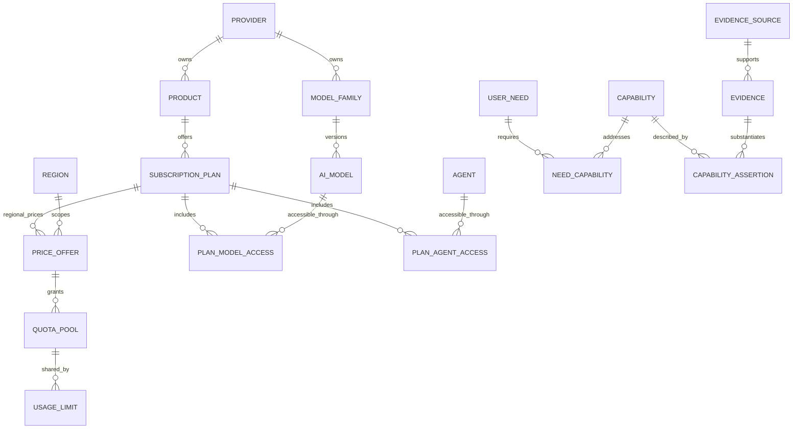

# AI Compass — архитектура P01–P07

## Граница

Модульный монолит: React/TypeScript → same-origin Vite proxy → Java/Spring Boot → PostgreSQL. В P01 Docker Compose управляет локальной БД; frontend и backend работают на хосте с закреплёнными инструментами. В P02 добавлены схема и внутренний импорт каталога; в P03 — явная публикация, read-only catalog API, OpenAPI и frontend каталога. В P04 добавлен детерминированный recommendation preview. P05 добавляет гостевую анкету/результаты, P06 — аккаунты и личное сохранение. Production images/Caddy ещё не реализованы; их границы остаются по CODEX_PROMPT.md.

Неизменённая миграция V1 создаёт схему `compass`; V2 добавляет каталог, V3 — защиту снимков. Служебная таблица Flyway ведёт историю миграций. Hibernate использует `validate`; `open-in-view` отключён. Пустая БД не получает демонстрационные тарифы.

Readiness включает DB health, но наружу отдаёт только `status`. `/actuator/env` закрыт. CSRF не отключён; HTTP-ошибки API используют Problem Details. Чтение scaffold/catalog API, OpenAPI и health разрешено анонимно; личные маршруты P06 требуют сессию и ownership.

## Закреплённые версии

| Компонент | Версия |
|---|---|
| Temurin JDK | 21.0.13+9 |
| Maven / Wrapper | 3.10.0 / 3.3.4 |
| Spring Boot | 4.1.2 |
| Spring Session JDBC/Core | 4.1.1, управляет Boot BOM через starter-session-jdbc 4.1.2 |
| springdoc-openapi-starter-webmvc-api | 3.2.0 |
| Flyway / PostgreSQL JDBC | 12.4.0 / 42.7.14, управляет Boot BOM |
| JUnit Jupiter / Testcontainers | 6.0.3 / 2.0.5, управляет Boot BOM |
| PostgreSQL | 17.12-bookworm, digest в Compose и интеграционном тесте |
| Node / npm | 24.22.3 / 11.19.1 |
| React / React DOM | 19.3.1 |
| React Router / TanStack Query | 8.5.1 / 5.107.1 |
| @hey-api/openapi-ts (dev) | 0.99.0 |
| TypeScript | 6.0.3 |
| Vite / React plugin | 8.3.8 / 6.2.1 |
| Vitest / Testing Library React | 5.1.0 / 16.3.3 |
| ESLint / @eslint/js / typescript-eslint | 10.15.0 / 10.0.1 / 8.72.2 |
| Prettier | 3.10.1 |
| Playwright | 1.64.1; Chromium фиксированной ревизии в project-local cache |

Все прямые frontend-версии фиксированы без диапазонов, транзитивные версии и integrity — в `package-lock.json`. Maven-зависимости управляются фиксированным Boot parent. Maven Wrapper проверяет SHA-256 дистрибутива. Локальный Maven settings направляет репозитории зависимостей только в Maven Central и не меняет глобальные настройки.

TypeScript 7 из последнего релиза не выбран: [typescript-eslint](https://typescript-eslint.io/users/dependency-versions/) декларирует поддержку `<6.1.0`. React plugin допускает Vite 8; Vitest 5 допускает Vite 8 и Node 24. `@eslint/js` имеет собственную версию 10.0.1 с peer `eslint ^10.0.0`; предположение о совпадении версии с ESLint было исправлено после отказа npm.

Официальные источники и реестры, проверенные на P00/P01:

- [Spring Boot requirements](https://docs.spring.io/spring-boot/system-requirements.html), [managed dependencies](https://docs.spring.io/spring-boot/appendix/dependency-versions/coordinates.html), Maven Central: `https://repo.maven.apache.org/maven2`.
- [Temurin 21.0.13+9](https://github.com/adoptium/temurin21-binaries/releases/tag/jdk-21.0.13+9), [Node 24.22.3](https://nodejs.org/en/download/archive/v24.22.3).
- npm registry `https://registry.npmjs.org`: версии и peer dependencies сверены до успешного install/build.
- [PostgreSQL versioning](https://www.postgresql.org/support/versioning/), официальный образ `postgres`.
- [Playwright Docker](https://playwright.dev/docs/docker): первоначально выбранный образ `v1.64.1-noble` (manifest digest `sha256:2f05f8a734509a7b3f26a912639488ee08f58a7b292d14d62271bcff9038768f`) не удалось скачать: две одинаковые ошибки сохранения слоя containerd. Без вмешательства в Docker использован разрешённый project-local Chromium из того же Playwright. Arch официально не поддерживается; CI-файл использует Ubuntu 24.04. Manifest подтверждён, работоспособность Docker-образа не заявляется.

P03: четыре новые прямые зависимости явно разрешены владельцем и закреплены точно. Перед установкой проверены официальные Maven Central/npm metadata и [springdoc](https://springdoc.org/): springdoc 3.x для Boot 4, Router 8.5.1 требует Node >=22.22.0 и React >=19.2.7, Query 5.107.1 поддерживает React 18/19, openapi-ts 0.99.0 требует Node >=22.18.0 и допускает TypeScript 6. Установленные Node 24.22.3, React 19.3.1 и TypeScript 6.0.3 подходят; совместимость с Boot 4.1.2 и Vite 8.3.8 дополнительно проверена реальными backend/frontend сборками, интеграционными и браузерными тестами. Другие прямые зависимости не добавлялись; peer checks не обходились.

## Локальная изоляция

Compose project и volume принадлежат AI Compass. Привязки портов — только loopback. `.env` создаётся с правами 0600, случайным паролем, не коммитится и не выводится командами проверки. `compose config` вызывается с `--quiet`.

Интеграционные тесты используют настоящий PostgreSQL Testcontainers с тем же digest и отдельной БД; H2 отсутствует. В Testcontainers адрес образа записан как `postgres@sha256:...`: сочетание tag+digest не прошло внутреннюю проверку имени. Это тот же официальный образ, а не замена БД или ослабление теста.

Ryuk не запускается, так как требует Docker socket в контейнере. Очистка собственного тестового контейнера выполняется Java-кодом и shutdown hook. Принудительный kill требует ручной проверки оставшихся только проектных ресурсов. Существующие контейнеры машины не затрагиваются.

## Проверка владельцем

После `bash scripts/dev-up.sh` открыть frontend, дождаться «Сервис доступен», выполнить `bash scripts/test-persistence.sh`, затем `bash scripts/dev-down.sh`. P01 принят владельцем. P02 принят владельцем; P03 закрыт (DONE): по поручению владельца проверены 5 утверждений по первоисточникам и повторены обязательные tests; протокол — PROGRESS.md. Каталог доступен на `/catalog`; P04 не начат.

## P02: модель каталога

Все предметные строки принадлежат `catalog_version`: PK `(version_id, id)`, FK включают `version_id`. Стабильный текстовый `id` сохраняет идентичность сущности между снимками, но связь всегда указывает на конкретную версию. Это запрещает случайно объединить цену одной версии и возможности другой. Личные профили и подписки пользователя появятся на своих этапах; `user_need` сейчас только справочник потребностей, без персональных данных.

| Таблица | Назначение и основные связи |
|---|---|
| `catalog_version` | UUID снимка, schema version, DEMO/REVIEWED, DRAFT/PUBLISHED, SHA-256, asOf, publishedAt, reviewer, исходный нормализованный manifest |
| `provider` | Поставщик и его домен; не продаваемый тариф |
| `product` | Приложение/инструмент автоматизации, provider, slug, active/retired, evidence метаданных |
| `model_family` | Семейство моделей одного provider; без оценок качества |
| `ai_model` | Точная версия модели внутри семейства |
| `agent` | Агент, provider, необязательный реализующий его product, среда исполнения и evidence |
| `subscription_plan` | Тариф продукта, tier, APPLICATION/API/BOTH, сроки и exclusivity group |
| `exclusivity_group` | Взаимоисключение внутри одного product; составной FK запрещает группу другого продукта |
| `region` | ISO country code; наличие региона в справочнике не доказывает доступность предложения |
| `price_offer` | План + регион + канал + период + дата действия; цена, upfront, налоги, сборы, trial, отдельные evidence цены/налога/сбора/доступности |
| `plan_model_access` | M:N plan ↔ точная модель, режим, availability, условия, evidence |
| `plan_agent_access` | Включённый в plan агент; связь не создаёт вторую покупку |
| `capability` | Функция, платформа, язык интерфейса/результата, privacy или license requirement |
| `user_need` | Выбираемая потребность, отдельно от технической функции |
| `need_capability` | M:N need ↔ capability; несколько нужд могут ссылаться на одну функцию |
| `capability_assertion` | Утверждение для одного product **или** plan, SUPPORTED/PARTIAL/UNSUPPORTED/UNKNOWN, условия, evidence |
| `quota_pool` | Один региональный pool предложения: количество/единица/reset/expiry; KNOWN/UNKNOWN/UNLIMITED |
| `usage_limit` | Функция/режим расходуют pool того же offer; unitsPerUse неизвестен → null |
| `eligibility_rule` | Требование региона, студенческого подтверждения, платформы, оплаты, privacy или языка; UNKNOWN допустим |
| `evidence_source` | URL, publisher, OFFICIAL/INDEPENDENT_BENCHMARK/USER_REPORT/SYNTHETIC, usage rights |
| `evidence` | Утверждение о конкретном типе поля, статус, source, фактическая дата проверки, регион/канал, reviewer, метод, условия |
| `benchmark_observation` | Только exact model, task/metric, точное знаковое измерение, единица, методология/дата/evidence; не рейтинг подписки |
| `fx_snapshot` | Явная пара ISO валют, положительный точный курс, дата, source через evidence; никаких автоматически придуманных курсов |

Основные связи (каждое ребро дополнительно ограничено одной catalog version):

Нет отдельной таблицы для каждой характеристики UI и нет схем пользователей/платежей заранее. JPA остаётся в стеке и `ddl-auto=validate` сохранён. Для атомарного пакетного импорта используется существующий Spring `JdbcTemplate` внутри `@Transactional`: явные SQL и составные FK проще, чем большой изменяемый JPA object graph. Собственная ORM, generic repositories и дополнительные зависимости не добавлены.

## Деньги и неизвестность

`Money` хранит `BigDecimal` и `Currency`, запрещает отрицательные расходы, невалютные ISO-коды и точность больше 6 десятичных знаков. JSON money/quantity/rate/measurement — строки. PostgreSQL использует отдельные domains для денег, количеств, измерений и FX. Денежные и количественные значения ограничены диапазоном `[0, 10^12)`, точностью 6; FX — `(0, 10^12)`, точность 12; измерения могут быть отрицательными. ISO monetary codes зафиксированы из JDK 21.0.13, включая исторические валюты для старых снимков; расширение требует миграции. Код валюты не означает наличие курса.

Выбран `numeric` без принудительной scale с CHECK: избыточная точность отклоняется вместо скрытого округления. Для nullable price CHECK требует `IS TRUE`, чтобы SQL NULL не обходил инварианты. Основания: [PostgreSQL numeric](https://www.postgresql.org/docs/17/datatype-numeric.html), [CHECK/NULL](https://www.postgresql.org/docs/17/ddl-constraints.html).

- `UNKNOWN`: amount и upfront равны null. UNKNOWN price evidence не может подкрепить известную/бесплатную цену — запрет в validator и БД.
- `FREE`: настоящая нулевая повторяющаяся цена, monthly period, upfront 0; налоги/сборы всё равно отдельные поля.
- `FIXED`: положительный платёж за MONTH/YEAR/ONE_TIME и полный базовый upfront не меньше платежа за период.
- `TRIAL`: ONE_TIME, явное число дней; нулевая trial-цена не превращается в recurring Free.
- `USAGE_BASED`: цена единицы с usageUnit; без объёма итоговая стоимость отсутствует.
- Налог INCLUDED/NOT_APPLICABLE имеет additionalTax 0; EXCLUDED_KNOWN хранит доплату; UNKNOWN — null. Аналогично известный/неизвестный сбор.

`OfferCosts` возвращает **компоненты**, а не заключение о пригодности: base recurring/upfront и отдельно all-in components, если дополнительные расходы известны. Доплаты модели P02 относятся к одному периоду счета и добавляются к первому счету; разные разовые/периодические add-ons и персональный график платежей относятся к P04/P07. STALE/CONDITIONAL evidence и региональная пригодность должны проверяться будущим engine отдельно: наличие вычисленного компонента не означает подтверждённый budget-fit.

Годовые 120.01 в синтетическом кейсе дают месячный эквивалент 10.000834, округлённый вверх до 6 знаков для безопасного сравнения, и upfront 120.01. Эквивалент не заменяет списание. `FxConversion` требует явный snapshot/asOf и RoundingMode, не ищет и не инвертирует курс. Курс возрастом >=24 часов или из будущего отклоняется; HALF_EVEN подходит для представления, CEILING — для консервативного сравнения бюджетов. Это чистая арифметика: выбор подтверждённого источника остаётся обязанностью вызывающего компонента.

Clock внедряется как bean UTC; тесты используют фиксированный asOf. `RenewalSchedule` сохраняет календарную anchorDate и billingZone, вычисляет очередное событие от исходного дня: 31 января → конец февраля → 31 марта; 29 февраля восстанавливается в високосный год. Полный ledger текущих пользовательских подписок не реализован в P02.

## Достоверность и воспроизводимый импорт

`CatalogJson` читает строгий typed record: неизвестные/пропущенные поля, duplicate keys, числовые деньги, числовые даты и trailing JSON запрещены. Даты — ISO-8601 UTC с Z. Bean Validation проверяет форму; `CatalogImportValidator` — связи, источник для нужного поля, даты, валюты, UNKNOWN, trial, группы, pools и demo isolation. Валидация ссылок сообщает путь и причину. Утверждения об отсутствии функции требуют evidence так же, как утверждения о поддержке.

JSON Schema draft-07 хранится в `data/schema/catalog.schema.json`; `check-catalog.sh` проверяет fixture и отрицательные shape-кейсы через уже установленный Ajv 6.15.0 из lockfile ESLint. Java runtime не запускает Node: Bean Validation + semantic validator проверяют импорт независимо. При изменениях контракта обновляются schema, records и обе группы тестов. Ajv сейчас транзитивный инструмент проверок; обновление ESLint обязано сохранить работоспособность `check-catalog.sh` или явно закрепить замену.

В `CatalogImportService` одна транзакция: validate → canonical JSON/hash → DRAFT → связанные строки → PUBLISHED. Retry того же versionId/content возвращает тот же id без дублей; другой content с тем же id запрещён. DB UNIQUE/FK failure откатывает **всю** транзакцию. Сохранённый manifest — неизменяемый входной артефакт для экспорта/воспроизведения, не второй редактируемый каталог. Нормализованные таблицы предназначены для будущего runtime API.

V3 блокирует UPDATE/DELETE/INSERT для опубликованных строк, замену метаданных опубликованной версии и TRUNCATE. Любой writer блокирует строку версии через `FOR UPDATE`; publication использует ту же блокировку. Содержимое evidence нельзя обновлять даже в draft: исправление требует нового claim id; неиспользуемый draft claim можно удалить. Исправление опубликованных данных — новый versionId, старый снимок сохраняется. Защита относится к обычному DML; владелец БД/superuser с правом менять DDL не является недоверенным runtime-пользователем. Разделение production DB roles — эксплуатационный этап.

Source kind и evidence status независимы: официальное заявление не равно независимому тесту; пользовательское мнение не превращается в benchmark. Benchmark ссылается на точную модель и методику, не наследуется family/новой версией/приложением. STALE/CONDITIONAL/CONFLICTED сохраняются. В P02 freshness scheduler и выбор active version отсутствовали; P03 ниже добавляет явную активацию и вычисление свежести при чтении. Фоновый scheduler по-прежнему не реализован.

## Demo isolation и граница P02

Пустая БД после миграций содержит **0** catalog versions/тарифов. Fixtures лежат только в `data/fixtures`, попадают в test resources, не в runtime JAR. У них синтетические имена и `.invalid` source URLs; вымышленный FX явно DEMO. Они не утверждают реальные цены/доступность даже для используемых в примере ISO-регионов.

По умолчанию `compass.catalog.allow-demo=false`. Включение возможно только при явно заданных профилях dev/test; prod/staging/смешанные профили запрещены. В режиме без demo импорт и чтение DEMO блокируются, запуск с уже имеющимися DEMO версиями в БД завершается ошибкой. REVIEWED не принимает DEMO evidence и SYNTHETIC sources. Отсутствуют auto-seed, публичный import endpoint и загрузка URL.

Публичный catalog API, CLI review/publish/activation, реальные reviewed manifests и DATA_POLICY — P03. Recommendation Engine — P04. P02 предоставляет ему воспроизводимый version id, связи потребностей/возможностей, отдельные cost components, неизвестность/условия, product-tier conflicts и shared pools; сами подбор и ranking не реализованы.

## Проверка архитектуры при закрытии P02

1. **Версии и конкуренция.** Единственной текущей/активной версии в P02 нет: `readPublishedArtifact(UUID)` требует явный id и `state = PUBLISHED`, с отдельной политикой доступа к DEMO. Нет выбора по `MAX(published_at)` или порядку завершения импортов. Активация reviewed каталога относится к P03 (§17 плана). Разные UUID импортируются отдельными транзакциями и блокируют разные строки `catalog_version`; одинаковые entity ids в разных снимках допустимы благодаря составным PK/FK. Оба корректных импорта могут завершиться PUBLISHED, сохранив собственные значения; это не конкуренция за статус active. Отдельный integration test проверяет одновременный старт разных версий с разной ценой, чтение обеих и отсутствие потери строк. Retry одинакового UUID/content и запрет перезаписи другим content проверяются существующими тестами.
2. **Смысл неизвестности.** `CapabilityState` описывает само утверждение, а `EvidenceStatus` — доказательность. `UNSUPPORTED + VERIFIED_SOURCE` означает подтверждённое источником отсутствие функции; UNSUPPORTED без анализа evidence не означает подтверждения. Условное/спорное/устаревшее заявление сохраняет CONDITIONAL/CONFLICTED/STALE и условия, не становится проверенным фактом. При недостаточных данных используется `UNKNOWN` либо отсутствующая assertion; отсутствие строки не означает UNSUPPORTED. UNKNOWN evidence не может обосновывать ни SUPPORTED, ни UNSUPPORTED: это проверяют validator, DB trigger и отрицательные тесты. DEMO всегда остаётся синтетическим. Интерпретация актуальности и пригодности в подборе относится к P03/P04.
3. **Связи и границы модулей.** `plan_model_access` и `plan_agent_access` — M:N; уникальны пары/режимы, не один plan_id или model_id. Одна модель доступна нескольким продуктам через их планы; один план допускает несколько моделей и агентов, что проверено PostgreSQL-тестами. Все 23 таблицы принадлежат каталогу и ссылаются только друг на друга; `user_need` — taxonomy, не пользовательский профиль. В production Java есть зависимость catalog → shared.money, обратных ссылок shared → catalog и зависимостей от identity/billing/portfolio нет. Число таблиц не создаёт отдельных модулей/сервисов. Измерение производительности будущих catalog queries ещё не выполнено; это не основание для структурного рефакторинга сейчас.

В рамках этой проверки ошибок, требующих изменения production-кода или миграций, не выявлено. Добавлены только проверки недостающих архитектурных сценариев и пояснения. Механизм active version намеренно не реализован за границей P02.

## P03: публикация и публичное чтение

V1–V3 не изменены. V4 добавляет catalog_review (sealed hash), catalog_publication (append-only audit) и singleton catalog_active. В БД 26 таблиц каталога. P02 state=PUBLISHED по-прежнему означает sealed import; право public read появляется только после явной активации. Нет выбора latest timestamp.

CatalogPublicationService блокирует singleton FOR UPDATE, сравнивает монотонную expected revision, записывает событие и обновляет pointer в одной транзакции. Несовпадение отклоняет конкурирующую команду, включая случай A→B→A. Rollback разрешён только на ранее активированный reviewed snapshot. Ошибка записи pointer откатывает уже вставленное событие, что проверяется fault-injection integration test. DB triggers защищают append-only review/history и единственную строку pointer; production privileged DB owner по-прежнему доверенный.

CatalogReadService использует REPEATABLE_READ и выбранный UUID во всех запросах. Public version selector допускает только previously activated versions с действующей demo policy. Читаются нормализованные таблицы, не manifest_json. CatalogResource — закрытый список таблиц/колонок, DataClassRowMapper — стандартный Spring mapper record DTO; пользовательские значения передаются параметрами SQL. Public evidence/source records исключают reviewer, method и usage-rights notes. Detail возвращает связанные строки выбранного продукта, источники, effective freshness и отдельные стоимостные компоненты.

Списки используют SQL limit/offset, кроме компактных evidence/source списков. Product detail загружает таблицы выбранного snapshot и фильтрует связи в памяти; manifest ограничен 10 000 строк на список. Для большего production-каталога нужно измерить эти запросы до оптимизации. Кеш между версиями не используется.

CatalogCommand запускается только при явном --catalog-command; CompassApplication выбирает non-web mode, SecurityConfig применяется только к servlet application. Обычный сервер сохраняет CSRF и запрет записи. CatalogPolicy проверяется до CLI runner. scripts/catalog.sh не принимает SQL и не загружает URL; исходный manifest — только локальный файл до 5 MB.

Источники начального manifest прочитаны вручную; pipeline не выполняет scraping. DATA_POLICY фиксирует неизвестные региональные цены, поля и срок свежести. OpenAPI и интерфейс каталога описаны ниже. Реализация не означает приёмки этапа владельцем.

### Контракт и frontend

`GET /api/v1/openapi` генерируется springdoc из реальных контроллеров, а не ручной спецификации. Schema ограничена `/api/v1/catalog/**`, `/api/v1/recommendations/preview`, `/api/v1/auth/csrf`, относительный server `/` сохраняет same-origin. DTO records сериализуют все поля: OpenApiConfiguration отмечает их required, nullable размечен явно у допускающих null полей. BigDecimal стоимости публично передаются строками; UNKNOWN и отсутствие значения не превращаются в 0/false. Контракт 200 содержит конкретный DTO, 400/404 — общий публичный ApiProblem. Schema не содержит import/review/publish/rollback и внутренних reviewer/hash/manifest.

ScaffoldIT получает схему настоящим HTTP-запросом с реальной PostgreSQL, проверяет её и сохраняет в target/openapi.json. `generate-api.sh` обновляет docs/openapi.json и генерируемые TS-типы/SDK/native-fetch client через закреплённый openapi-ts. `check.sh` независимо сравнивает backend schema, затем повторно генерирует клиент во временный ignored каталог и проверяет отсутствие diff. Prettier вызывается программно с путём `.ts`, чтобы вывод не зависел от subprocess/имени временного каталога. Генерируемый код проверяется TypeScript; ESLint исключает только generated файлы. Ручных DTO-копий нет.

React Router: `/`, `/catalog`, `/catalog/:slug`, 404. TanStack Query кеширует данные по типу запроса, параметрам и versionId; список сначала получает meta, затем читает закреплённый snapshot. Детальные ссылки содержат version. Поиск/фильтры/пагинация выполняются API, параметры сохраняются в URL. Meta возвращает coverage summaries из того же snapshot. Фильтр возможностей учитывает assertions продукта и его тарифов. Loading/empty/error/retry и UNKNOWN отображаются явно; модели/агенты не выдаются за подписки. Тарифы показывают регион, валюту, base/upfront/annual equivalent, отдельные налоги/сборы, shared pools и eligibility. Каждое утверждение связано с evidence, effective status, датой и source URL. Синтетические массивы используются только в тестах.

### Проверки P03

Backend: unit + настоящая PostgreSQL; публикация/конкуренция/rollback/история, demo isolation, nullable money, freshness, публичные GET и запрет записи. Frontend: 18 UI-тестов, включая 11 каталога, с generated SDK и подменой HTTP только в unit tests. E2E: 11 браузерных тестов, включая 8 каталога, настоящий backend и CLI. Отдельный PostgreSQL запускается с tmpfs, случайным паролем и loopback-портом; постоянных volumes нет. Завершение останавливает только собственные процессы и контейнер. Dev data не изменяются. Проверяются три ширины, keyboard skip link, отсутствие горизонтального overflow/page errors, обновление/rollback, UNKNOWN/FREE и региональные суммы без конвертации.

Playwright на Arch использует прежний Ubuntu 24.04 fallback; официальная поддержка Arch не заявляется. CI содержит отдельную загрузку закреплённого Chromium, но удалённый workflow ещё не выполнялся. Наличие workflow не является результатом CI. Полный accessibility/security/load audit и production DB role separation остаются задачами последующих этапов; текущие checks не заменяют их.

## P04: детерминированный Recommendation Engine

Граница модуля: `recommendation` получает immutable `PublishedCatalogSnapshot` через `catalog.CatalogReadService.currentSnapshot()`. UUID активной публикации читается один раз в транзакции PostgreSQL REPEATABLE READ; все нормализованные таблицы читаются с этим UUID. После копирования списков транзакция заканчивается, перебор не держит DB connection. Движок не читает manifest JSON, HTTP, системное время или LLM. Каталог не зависит от recommendation. Новых таблиц, миграций и dependencies в P04 нет.

| Компонент | Ответственность |
|---|---|
| `ProfileValidator` / `RecommendationProfile` | Строгий JSON, Bean Validation, деньги, уникальность, календарь и ограничения размера |
| `RecommendationService` | Один Clock/asOf, один опубликованный snapshot, вызов чистого ядра |
| `EvidenceAssessment` | Свежесть на asOf, CONDITIONAL/UNKNOWN/STALE/CONFLICTED, явное принятие условия |
| `EligibilityAssessment` / `CandidateResolver` | Страна, канал, платформа, языки, privacy, студент, active periods, retained subscriptions |
| `CostCalculator` | BigDecimal/Money/FX, recurring/upfront/cash now/horizon, календарь продлений |
| `CapabilityCoverage` | Объединение функций, hard requirements, веса без вымышленного качества |
| `UsageAssessment` | Проверенный объём действий с режимом и единицами, общие пулы и срок кредита |
| `BundleSearch` | Ограниченный перебор, отсечения, безопасное доминирование, три стратегии |
| `RecommendationEngine` / `RecommendationResult` | Версии, дедупликация, причины, альтернативы, неопределённость |
| `RecommendationController` / `PreviewLoadGuard` | HTTP, CSRF, Problem Details, ограничение нагрузки |

### Профиль v1

Все поля присутствуют; nullable передаются как `null`. Непредусмотренные поля, duplicate JSON keys, numeric money, отрицательные суммы, неправильные enum/currency/date отвергаются с 400. `asOf` — UTC ISO string с Z либо null (серверное время), не будущее, максимум год назад, не раньше asOf активного snapshot. Старый `catalogVersion` клиенту подставлять нельзя: public preview работает только с текущей публикацией. Чистое ядро воспроизводит старый результат при передаче прежнего immutable snapshot, профиля, asOf и policy.

- `needs`: 1–12 уникальных id из taxonomy, weight 1–5, required, intensity OCCASIONAL/WEEKLY/DAILY. Неизвестная потребность остаётся unmet UNKNOWN.
- `budget`: ISO currency, decimal strings monthlyMax/upfrontMax, scope=ALL_AI. Суммы профиля до 999999999.999999, максимум 6 дробных знаков. `horizonMonths` 1–24, `maxTools` 1–4, annual требует явного opt-in.
- country ISO2, interfaceLanguage и outputLanguages; platforms и privacy LOCAL_ONLY/NO_STRICT_REQUIREMENT. Факты ограничений используют capability ids `platform-linux`, `interface-language-ru`, `output-language-en`, `privacy-local-only`. Отсутствующий id не означает поддержку. Ограничения проверяются для каждого инструмента набора.
- `requirements.features`: до 32 явных функций с весом/required. `usage`: до 16 запросов capabilityId/mode/monthlyQuantity/unit/required. Интенсивность сама по себе не превращается в число генераций.
- `existingSubscriptions`: до 8, id, planId/offerId или оба null для custom, currency/amount (null допустим), MONTH/YEAR, **исходная renewalAnchor**, nextRenewal, billingZone, mustKeep. Валидатор сверяет nextRenewal с исходным календарным якорем: 31 января → февраль → 31 марта, а не постоянное смещение на 28-е.
- `portfolioMode=AUGMENT` сохраняет все существующие покупки, REVIEW разрешает исключить только не mustKeep. Известный существующий plan не покупается повторно. Custom учитывается в стоимости, но его функции/доступность UNKNOWN.
- `acceptedConditionEvidenceIds` разрешает конкретное подтверждённое PARTIAL или CONDITIONAL условие функции; UNKNOWN/STALE/CONFLICTED не становится доказательством. SELF_DECLARED и даже USER_REPORTED_PROVIDER_VERIFIED не дают гарантированную студенческую скидку.

### Стоимость и пригодность

Деньги — BigDecimal/Money с валютой, JSON — строки или null. All-in charge = base + известные дополнительные tax + fee; неизвестные компоненты сохраняют null. Для годового тарифа recurring = charge / 12 с округлением вверх до 6 знаков, но cashDueNow/upfront требуют всю сумму. Horizon считает первый платёж и последующие календарные периоды до исключающей верхней даты. Это проекция условий snapshot, не обещание неизменности будущих цен. Явное окончание тарифа раньше горизонта делает полный итог неизвестным.

Горизонт existing subscriptions имеет дневную точность в billingZone: от начала текущей локальной даты включительно до начала даты `today + horizonMonths` исключительно. Час расчёта не добавляет платёж на правой границе; исправление помечено engineVersion=1.0.1.

Существующий amount — пользовательская сумма с налогами/сборами, confidence=ESTIMATED; продления идут от original anchor в billingZone. Уже оплаченный период не оплачивается повторно. Предложение CANCEL_AT_RENEWAL не создаёт refund и не отменяет подписку. FutureMonthly — регулярный расход предложенного портфеля после предполагаемых отмен; potentialNetMonthlySavings — только разница с известной пользовательской базой, может быть отрицательной. Без базы/цены/FX экономия null.

Trial, ONE_TIME и USAGE_BASED не доказывают постоянную бесплатную подписку. Срок кредита, reset, unit и mode проверяются отдельно. Поддерживается подтверждённое месячное потребление в `actions` с unitsPerUse; ежедневные квоты, неизвестная стоимость дополнительных кредитов и произвольные межпровайдерские credit conversions не додумываются. Обязательный объём должен целиком размещаться в проверенном пуле; разделение одной потребности между несколькими пулами пока не доказывается. Общий pool ID учитывается единожды. Без количественной потребности `usageFit=UNKNOWN`, а не «лимита точно хватит».

FX — только прямой подтверждённый snapshot моложе 24 часов, не из будущего, с округлением вверх до minor unit целевой валюты. Все использованные FX возвращаются с provenance. Нулевая сумма не требует обменного курса. Compass fee задаёт серверная policy как Money (в P04 0 USD); пользователь не присылает её. Для гипотетического платного сценария fee конвертируется и входит в cash/upfront/monthly/horizon/net savings. Версия policy включает исходную валюту и сумму fee.

ELIGIBLE, CONDITIONAL, UNKNOWN, INELIGIBLE не смешиваются. Основные bundles требуют подтверждённых стоимости и hard constraints; условные/неизвестные предложения доступны отдельно только при выполненном hard функциональном покрытии и отсутствии известного превышения бюджета. Публичная региональная цена не доказывает доступность покупки. API-only план не заменяет приложение.

### Покрытие, перебор, стратегии

Need→capability берётся из snapshot. Пересекающаяся функция считается один раз с максимальным весом и required=OR; максимум 256 разрешённых функций. SUPPORTED с актуальным evidence даёт подтверждённое покрытие; PARTIAL не получает коэффициент 0.5. Для необязательных UNKNOWN/UNSUPPORTED/непринятого PARTIAL вес не начисляется. W — доля суммы подтверждённых весов, **не рейтинг качества**. Конфликтующие утверждения дают UNKNOWN. Независимые benchmark scores моделей не переносятся на продукты и не участвуют в P04 без сопоставимых данных; `UNKNOWN_QUALITY` видим.

1. Сохраняются все mandatory, остальные сортируются по стабильному id. При >40 суммарных кандидатов берётся детерминированное подмножество, `searchComplete=false` и SEARCH_TRUNCATED; глобальная оптимальность не заявляется.
2. Перебираются сочетания до maxTools (не порядок перестановок). Известные нижние границы monthly/cash и конфликт продукта/explicit exclusivity group отсекают ветку. Разные продукты одного vendor совместимы, если нет конкретного ограничения.
3. Hard functions и shared quotas проверяются до ранжирования. Для распределения квот лимит 10 000 попыток на сочетание; превышение даёт неопределённость и `searchComplete=false`.
4. Доминирующие удаления безопасны: необязательная новая покупка удалима лишь при неизменном confirmed/accepted покрытии, отсутствии количественного usage и неотрицательных расходах. MustKeep/retained не удаляются. Никаких quality/brand/affiliate отсечений.
5. ECONOMY: минимальная monthly cost, затем больший W, меньше инструментов/новых покупок, меньше cash now, stable id. EXPANDED: максимальный W, затем та же стоимость/простота. BALANCED: W не дальше 0.05 от максимума, затем минимальная стоимость/простота. Допуск — versioned product policy. Priority меняет порядок показа стратегий, не hard constraints.
6. Одинаковые item sets возвращаются один раз с несколькими strategy labels. Отсутствие трёх разных наборов честно помечается. Матрица coverage, factual/policy reasons, evidence/source ids и unmet сохраняются.

Основные codes: WITHIN_BUDGET, PRICE_INCOMPLETE, ANNUAL_UPFRONT_REQUIRED, STUDENT_VERIFICATION_REQUIRED, REGION_UNKNOWN/INELIGIBLE, PLATFORM_UNKNOWN, LANGUAGE_UNKNOWN, PRIVACY_UNKNOWN, MISSING_REQUIRED_FEATURE, UNKNOWN_CAPABILITY, SHARED_QUOTA, USAGE_UNKNOWN/EXCEEDED, TRIAL_NOT_RECURRING, KEEP_EXISTING, INCLUDED_AGENT/MODEL, UNKNOWN_QUALITY, STALE_EVIDENCE, CONFLICTED_EVIDENCE, BUDGET_CONFLICT, UPFRONT_CONFLICT, RETAINED_CONFLICT, FX_MISSING, LIMITED_CATALOG, SEARCH_TRUNCATED, NO_DISTINCT_ALTERNATIVE, NO_MATCH. Полный enum и DTO — в generated OpenAPI.

### Preview HTTP и границы безопасности

`GET /api/v1/auth/csrf` выдаёт session-bound token, `POST /api/v1/recommendations/preview` принимает профиль, возвращает 200 для MATCH/CONDITIONAL_ONLY/NO_MATCH/NO_PUBLISHED_CATALOG. Ошибки 400/403/413/429 используют ApiProblem и requestId. Оба endpoint `Cache-Control: no-store`; body до 64 KiB. In-memory fixed-window limit: 30 запросов/минуту на remote IP, 120 глобально, максимум 2 параллельных; 429 содержит Retry-After=60. Forwarded headers не считаются доверенными. При same-origin proxy клиенты могут делить один IP: это консервативный локальный лимит, distributed production limiter — вне P04.

CSRF и session cookie защита не отключены. Локальный HTTP/test снимает только Secure-флаг cookie; production default сохраняется. В границах P04 preview не сохраняет профиль/результаты. Отдельные personal write endpoints добавлены в P06 ниже; платежей нет. Публикация по-прежнему только CLI; source-fetch/LLM/payments OFF. Frontend получает generated DTO/SDK, но анкета/страница результатов P05 не создаётся.

### Воспроизводимые проверки и benchmark

`RecommendationEngineTest`, `ProfileAndInvariantTest`: синтетические edge cases и 160 профилей с seed 4042026; budget/upfront/required/uniqueness/determinism. `RecommendationIT`: реальная PostgreSQL, import→review→publish→HTTP, пустая БД, конкурентная активация/rollback, ограниченный реальный r2, CSRF/413/429 и отсутствие публичной записи. E2E использует отдельный tmpfs PostgreSQL и браузерный same-origin POST, не dev-каталог.

`bash scripts/benchmark-recommendation.sh` отдельно запускает RecommendationBenchmark: 40 синтетических кандидатов, maxTools=4, высокий бюджет, 5 warmup + 20 измерений System.nanoTime, p95 nearest rank (19-е из 20). Измеряется чистый engine с фиксированными input/snapshot/asOf, не DB/network/startup и не production RPS. Проверяются 102 091 посещённый узел поиска (102 090 непустых сочетаний +1 пустой корень) и p95<1000 ms; результат в ignored `backend/target/recommendation-benchmark.txt`. Benchmark не маскируется пропущенным тестом в стандартной suite. Цифры фактического запуска и матрица T01–T36 приведены в PROGRESS.md.

Поле API `search.visitedCombinations` сохранено для совместимости: это число вызовов перебора, включая корень (пустой либо состоящий из mandatory subscriptions) и узлы до проверки ограничений. Оно не равно числу допустимых наборов. В benchmark без mandatory и отсечений `Σ C(40,k), k=1..4 = 40+780+9880+91390 =102090`; ещё один вызов — корень. Пустой корень никогда не становится feasible/recommendation. Отчёт отдельно печатает visited_search_nodes/non_empty_combinations/empty_root_nodes; для произвольного запроса с mandatory/отсечениями вычитать единицу как универсальную метрику нельзя.

## P05: гостевой AI Stack Builder

`App` содержит общий `BuilderSession` над маршрутами внутри React Router и существующий TanStack Query provider. `/onboarding` — три шага; `/results` — последний успешный расчёт; `/methodology` — объяснение правил/статусов. Главная и каталог используют общую навигацию. Неизвестные URL сохраняют 404-экран.

- `api/builder.ts` загружает все страницы products/plans/offers/models/agents/capabilities/needs/usage-limits из Catalog API, передавая один опубликованный `versionId`. Каждая страница сверяется с этим UUID. Это адаптер generated SDK, не новый источник данных или второй recommendation engine.
- `builder/draft.ts` хранит UI-состояние незавершённой анкеты и проверяет наличие полей/decimal strings. API DTO импортируются из generated-контракта. Только заполненный профиль преобразуется в `RecommendationProfile`; UI-only `missingNeed` не отправляется. Денежная арифметика и ранжирование на клиенте отсутствуют.
- `BuilderPage` использует серверную taxonomy, выбор обязательности/весов/частоты, ограничений и бюджета. Отсутствующее направление показывается как ограничение каталога и блокирует полный подбор при обязательной отсутствующей потребности. Фиксированного frontend-справочника need IDs нет. Коды стран/языков объяснены рядом с вводом; платформа — пользовательское требование, а не заявление о её поддержке.
- `ExistingSubscriptions` позволяет выбрать опубликованное предложение или custom с null planId/offerId; цена берётся от пользователя, а не автоматически из публичного тарифа. Null-цена остаётся null. Calendar anchor, nextRenewal и IANA timezone проверяются окончательно сервером. AUGMENT/REVIEW/mustKeep передаются без самостоятельной интерпретации состава набора.
- `BuilderSession` держит черновик, шаг и результат в React memory. Нет browser storage, cookies с профилем, backend profile persistence или URL с анкетой. AbortController + возрастающий номер запроса исключают запоздалые ответы; синхронный ref блокирует дубли. Изменение профиля инвалидирует предыдущий результат. Кнопка очистки сбрасывает черновик/шаг/результат; пауза rate limit сохраняется. При уходе из формы незавершённый запрос отменяется.
- Перед каждым preview выполняется GET `/api/v1/auth/csrf` через same-origin generated SDK. Session-bound token существует только в памяти запроса и отправляется в именованном backend заголовке; профиль POST `/api/v1/recommendations/preview`. 400/403/413/429/500/network ошибки имеют русские сообщения. 429 учитывает Retry-After; retry получает новый CSRF. CSRF/security/limiter не ослаблялись.
- Версия результата обязана совпасть с версией данных формы. При конкурентной публикации ответ с другим UUID не отображается, форма предлагает обновление. Это исключает смешивание snapshot. Серверный input-контракт не расширялся.
- `ResultsPage` отображает server-order bundles и strategies без сортировки/генерации дополнительных наборов. Conditional alternatives отделены. Если strategies пуст (обычный контракт условных вариантов), заголовок строится из состава, без назначения ECONOMY/BALANCED/EXPANDED. Product links закреплены UUID результата; модели и включённые агенты перечислены отдельно.
- Costs передаются строками: cash now, upfront, recurring equivalent, futureMonthly, horizonTotal, baseline, potential net difference и Compass fee. Годовая сумма показывается только для horizon=12; для иного периода предлагается изменить горизонт, месячная сумма не умножается на 12 на frontend. FREE-badge требует подтверждённого полного бюджета и нулевых recurring/upfront/horizon; UNKNOWN цены, комиссии/налоги и FX не подменяются нулями. Базовая цена условного предложения помечена как неполная.
- Coverage, unmet, factual/policy reasons, conditions, assessments, evidence/source/date/status и версии доступны в результате. Никаких универсальных процентов качества. Внешние source links ограничены http(s), React экранирует текст, `rel=noreferrer` используется для новой вкладки.

Доступность: semantic headings/fieldset/labels, явный focus outline, skip link, focus на шаге/summary валидации/результате, role alert/status, disabled при отправке. Adaptive grid с `minmax(min(100%, …),1fr)` и переносы длинных идентификаторов; E2E проверяет отсутствие горизонтального overflow на 360/768/1440. UI tests работают на синтетических test-only fixtures, E2E — с реальной PostgreSQL/CLI публикацией/CSRF/API. Имитация HTTP 500/429 используется только для детерминированной проверки recovery UI, не заменяет проверки backend. Производственный a11y/security audit не заявляется выполненным; аккаунты описаны в P06 ниже.

## P06: identity и сохранение личных данных

`identity` отвечает за учётные записи, подтверждение адреса, reset, ограничения попыток и локальную почту; `portfolio` в P06 содержит только сохранённый профиль, исторические результаты и выбранные наборы. Это не реализация расходов/оптимизации P07. Модули работают в одном Spring Boot приложении и существующей PostgreSQL. Роли USER/ADMIN — ограниченное поле аккаунта, отдельная дублирующая таблица ролей не нужна.

Единственная новая прямая зависимость — `spring-boot-starter-session-jdbc`, управляемая Boot BOM 4.1.2. Фактическое дерево Maven: starter/autoconfigure/JDBC 4.1.2, Spring Session JDBC/Core 4.1.1, Spring Security 7.1.2. Другие прямые зависимости и ручные версии транзитивных модулей не добавлены.

### Схема и сессии

V5 создаёт `spring_session` и `spring_session_attributes` по стандартной PostgreSQL schema установленного Spring Session 4.1.1 в schema compass. `spring.session.jdbc.initialize-schema=never`; Flyway — единственный владелец схемы. Сериализацию, session IDs, expiration и удаление session attributes выполняет библиотека. Собственного session store/шифрования IDs нет. В session лежат стандартный SecurityContext с UUID/ролью (без password hash), CSRF, credentialVersion и время авторизации.

V6 создаёт `user_account`, `identity_token`, `auth_rate`, `saved_profile`, `recommendation_snapshot`, `saved_stack`. Итого 34 предметные/служебные таблицы compass, включая 26 прежних. Уникальные normalized email и owner профиля, FK/cascade, составной FK `(snapshot_id, owner_id)` исключают чужие saved stacks. V1–V4 неизменны. PostgreSQL JSONB хранит реальный типизированный RecommendationProfile и RecommendationResult; это не второй формат профиля или engine.

Пароли обрабатываются стандартным Spring Security PBKDF2 PasswordEncoder (defaultsForSpringSecurity_v5_8), проверка — DaoAuthenticationProvider. Login вызывает стандартные ChangeSessionIdAuthenticationStrategy и CsrfAuthenticationStrategy; SecurityContext сохраняется стандартным repository. Cookie HttpOnly/Lax/Secure, в dev/test Secure=false только для loopback HTTP. Idle timeout 30 минут, абсолютный срок авторизации 12 часов. Reset удаляет все сессии аккаунта и повышает credential_version; фильтр сравнивает версию с БД на каждом авторизованном запросе, поэтому позднее сохранение старой сессии не возвращает доступ. Logout отзывает текущую сессию, обычные concurrent sessions разрешены.

### Проверка адреса, reset, bootstrap и ограничения

Verify/reset получают 32 случайных байта SecureRandom; в БД хранится только SHA-256 digest, purpose, owner, expiry. TTL verify=24h/reset=30min. Новый запрос заменяет предыдущий token данного purpose; consume блокирует аккаунт и атомарно удаляет валидный token. Истечение и повторное использование возвращают одинаковую ошибку. Reset не подтверждает автоматически ранее неподтверждённый email. Регистрация дубликата выполняет password hash и возвращает тот же 202; неверный пароль, неизвестный или неподтверждённый email — один 401. Нормализация: strip + lowercase Locale.ROOT, уникальность также в PostgreSQL.

Лимиты хранятся в PostgreSQL (ключи — hash, не raw email/IP), транзакции REQUIRES_NEW сохраняют счётчики при неудачной операции. Окно 15 минут; login 10/email, register/resend/forgot 5/email, save 20/account, delete 5/account, общий auth/personal 300/IP. Старые rate buckets удаляются при следующих запросах спустя час. Forwarded IP не доверяется; за одним proxy клиенты делят лимит — production настройка ещё не заявляется. Body личных mutation до 64 KiB. Прежний preview limiter не ослаблен.

Dev/test sink — приватные файлы 0600 в каталоге 0700, нет SMTP, публичного чтения и вывода токенов в логи. В prod/staging доставка закрыта с 503. Fragment ссылки удаляется из browser history при открытии формы, token field маскирован. Файлы sink не являются обычными логами: содержат одноразовые секреты, остаются локально до удаления аккаунта/ручной очистки оператором. В БД истёкшие token rows недействительны, физически заменяются новым запросом или удаляются с аккаунтом. Production retention и доставку следует определить на соответствующем этапе.

AdminBootstrap — отдельный локальный non-web режим: транзакционная блокировка user_account, только существующий verified UUID, только первый ADMIN, повышение credential_version и отзыв сессий. Скрипт требует терминал и GRANT. Публичных admin операций нет; роль клиента отклоняется strict DTO parser.

### Ownership, snapshots и frontend

SecurityConfig явно разрешает public catalog/health/OpenAPI/preview и auth flow; me/profiles/recommendations/saved-stacks требуют сессию; остальные операции запрещены. Гость с валидным CSRF получает 401 на личных маршрутах; missing/invalid CSRF — 403; import/publish — 403 для всех. Владелец берётся только из серверного Principal. Все personal SQL ограничены owner; чужой UUID даёт 404. Optional `X-Compass-Account` — дополнительная UI-предпосылка: несовпадение текущей сессии с ожидаемым аккаунтом даёт 409; этот заголовок никогда не назначает владельца/права.

Free один профиль обеспечивается блокировкой аккаунта и UNIQUE(owner_id), update использует optimistic revision. Неизвестные поля/role/Premium/ownerId и JSON coercion отвергаются, вложенный профиль проходит существующий P04 validator. Сохранение результата принимает параметры, catalog/engine/policy version и asOf, заново вычисляет результат на сервере по опубликованному историческому каталогу. Клиентские цены/ранжирование не принимаются. Версии engine/policy, которые текущий backend воспроизвести не может, дают 409 с предложением пересчитать. Snapshot содержит весь результат с UNKNOWN/причинами/FX и далее неизменен: нет update endpoint. Повторный save создаёт отдельный snapshot. Saved stack должен принадлежать набору из своего snapshot; duplicate save идемпотентен. Предел 100 результатов и rate limit ограничивают сохранение/расчёт.

AuthSession хранит только публичные данные аккаунта в React memory. Вход гостя сохраняет его текущий черновик, но ничего не записывает автоматически. SavePanel требует явный checkbox, сообщает о замене единственного профиля и отправляет typed SDK запросы. Смена известного аккаунта, logout или подтверждённая потеря сессии очищают builder и personal query cache; focus/navigation проверяют session, account header защищает запросы при смене сессии в соседней вкладке. Перезагрузка гостевой вкладки теряет черновик по прежнему privacy-правилу P05. Dashboard загружает новый расчёт из профиля с текущим временем либо открывает immutable результат с его pinned catalog. DTO берутся из generated OpenAPI, auth tokens не записываются в local/sessionStorage.

Export выбирает только публичные account DTO и принадлежащие пользователю profiles/results/stacks. Delete требует password + confirm, удаляет аккаунт с cascade, session rows, известные account/email rate buckets и его локальные письма. IP rate bucket не принадлежит одному аккаунту и истекает отдельно. Общий каталог не удаляется. Эти механизмы не являются заявлением юридического compliance.

### Проверки P06

IdentityIT — реальная PostgreSQL/Testcontainers и HTTP, включая закрытие/повторный запуск Spring приложения, concurrent profile creation, A/B ownership, reset/reuse/expiry, fixation/CSRF, безопасный bootstrap, export/delete и поиск секретов в captured logs. Отдельные UI tests проверяют согласие, guest transfer, смену аккаунта и ошибки. Изолированные E2E выполняют регистрацию/verify через локальный sink, login/logout/reset, сохранение/rerun, IDOR, session expiry через собственную тестовую БД, export/delete и 360/768/1440. Auth traces/video выключены во избежание записи cookie. Числа и фактические результаты — в PROGRESS; удалённый CI, реальная почта, production deployment/pentest не выполнены.

## P07: личный реестр и Subscription Optimizer

`portfolio.SubscriptionService/Controller` управляют личными записями. V7 добавляет одну таблицу `user_subscription`, поскольку P02/P06 такой таблицы не имели. V1–V6 не изменяются. FK owner с cascade, ссылки на конкретные plan/offer/catalog version, уникальные owner/name и owner/plan, ревизия и conditional UPDATE/DELETE предотвращают дубли и потерю изменений. Все запросы включают owner из сессии. Максимум восемь записей соответствует границе профиля P04; это технический предел, не Premium. Account row lock сериализует CRUD и удаление аккаунта. Export P06 включает ledger; delete каскадно удаляет его.

Typed `SubscriptionTerms` хранится как JSONB вместе с индексируемыми ссылками/идентичностью и constrained numeric ценой. Дополнительные расходы, уже оплаченная сумма и переходные расходы — generated numeric columns с тем же money domain. Price state KNOWN/UNKNOWN и origin USER_REPORTED/CATALOG/UNKNOWN не смешиваются. Нулевое значение требует явного ввода. CATALOG принимается только при точном совпадении суммы/валюты/периода с опубликованным предложением и свежем подтверждённом evidence; ручная цена всегда USER_REPORTED. Это не новое evidence каталога. Null дат/сумм и явные UNKNOWN у статуса, автопродления и обязательства сохраняются. Дневные ISO даты (годы 0001–9999) интерпретируются в IANA billingZone; некорректная зона/дата отклоняется с 400 до записи в БД. Сохраняется исходный календарный anchor, в том числе при устаревшей записанной дате следующего платежа.

### Расчёт и границы достоверности

`recommendation.SubscriptionOptimizer` — композиция существующих CandidateResolver, RecommendationEngine, CapabilityCoverage, UsageAssessment и CostCalculator. Он не обращается к БД/HTTP. Ledger timeline добавлен в существующий CostCalculator; FX, BigDecimal, RenewalSchedule и evidence policy общие с P04. Внутренние overrides стоимости не принимаются из API: они вычисляются из принадлежащего пользователю ledger. P04 публичный DTO/алгоритм гостевого preview сохраняет прежнее поведение.

- CURRENT проецирует действующие условия продления. Оплаченная сумма показывается отдельно и не входит в будущий расход/экономию. MONTH/YEAR считаются календарными событиями в полуоткрытом интервале [today, today + horizonMonths); час расчёта не добавляет событие справа. Старое nextRenewal продвигается от исходного anchor, без выдуманного долга за прошлые даты.
- При autoRenew=NO и obligation=NONE будущих списаний нет; будущий доступ подтверждается в расчёте только если указанный paidUntil покрывает весь горизонт и доступ уже начался. Trial не считается постоянным бесплатным тарифом. Истёкшие/неизвестные условия не дают подтверждённого заменяющего набора. Оплаченный доступ и условия прекращения показываются явно.
- CANCEL_AT_RENEWAL — предложение прекратить списания не раньше cancellationAvailableFrom и commitmentUntil. Уже оплаченный период никогда не возвращается. До этой даты обязательные платежи остаются в OPTIMIZED. При неизвестной возможности отмены обязательная часть платежей — UNKNOWN, а не все запланированные продления; явный контракт подтверждает только свои события. Неизвестная отмена/обязательство/переходная сумма делает сравнение неполным; неизвестная ранее оплаченная сумма сама по себе не обнуляет известные будущие платежи.
- Новые покупки начинаются сейчас. Полный upfront и платежи за горизонт берутся из общего Offer cost calculator; оплаченный период пересечения возможен и явно указан. Автоматический отложенный запуск покупки/возврат не предполагается. Дополнительные налоги, сборы и пользовательский резерв usage/top-ups за период задаются отдельно; неизвестный объём/цена не подменяется нулём.
- Monthly — эквивалент указанного регулярного платежа; YEAR делится с прежним CEILING до шести знаков. Для отменяемой подписки с оставшимися обязательными платежами временная месячная нагрузка сохраняется консервативно до их окончания. Поэтому monthly не следует умножать на горизонт: точная проекция берётся из событий.
- FX — только существующий подтверждённый прямой snapshot моложе 24h, с provenance, без инверсии/догадок. Нулевая сумма не требует курса. Серверная Compass policy остаётся 0 USD; компонент fee берётся из engine и добавляется в альтернативу, новый billing не появляется.
- Потенциальная разница = CURRENT future horizon total − OPTIMIZED future horizon total, одна валюта/дата/горизонт. Sunk cost не участвует. При неизвестном компоненте общей будущей стоимости разница UNKNOWN, диапазон не выдумывается. Даже известная арифметика помечена ESTIMATED_USER_REPORTED: даты и условия введены пользователем. `confirmedSavings=null` честно отражает отсутствие независимого подтверждения. Нет гарантии экономии.
- MustKeep и AUGMENT не удаляются. Только bundles, прошедшие существующие hard functions/eligibility/usage/exclusivity, становятся альтернативами; полные переходные расходы дополнительно проверяются по лимитам. Если текущий подтверждённый набор не дороже всех рассмотренных допустимых альтернатив, KEEP_CURRENT. Недостаток данных даёт UNKNOWN/REVIEW_REQUIREMENTS. Отсутствие альтернатив не является доказательством отсутствия вариантов на всём рынке.
- Пересечения используют подтверждённые capability assertions, не категории/универсальные проценты. Включённые модели/агенты и общие quota pools берутся из прежнего resolver. Потерянные функции проверяются по каталогу, не только по текущим обязательным needs. Пересечение не доказывает равенства качества/лимитов. Custom/исчезнувший из текущего каталога plan имеет неизвестные функции, но сохраняет расход.

Один REPEATABLE_READ запрос фиксирует ledger revisions и активный immutable каталог; несовпадение переданных ревизий/UUID даёт 409. Транзакция чтения удерживается на время ограниченного локального расчёта. Ответ содержит исходный профиль/terms, asOf, catalog/optimizer/engine/policy versions и использованные FX, достаточные для повторения pure calculation. Автоматическая история анализа не записывается; существующие saved profiles/snapshots P06 не дублируются. Внутренние результаты P04 используются для выбора кандидатов, но его старые monthly-savings/actions не выдаются как финансовый итог P07: в `recommendations` остаются search metadata/evidence/assessments, итог — в scenarios.

### API, UI и безопасность

`GET/POST /api/v1/subscriptions`, `GET/PATCH/DELETE /api/v1/subscriptions/{id}`; DELETE требует revision. `POST /api/v1/subscriptions/analyze` возвращает CURRENT, альтернативы, графики, overlap, объяснения и ограничения одним согласованным ответом. Вход: существующий RecommendationProfile с пустым existingSubscriptions, catalogVersion и map ledger revisions. Все операции требуют сессию; mutation — CSRF. Body до 64 KiB, общий personal IP limit 300/15min, анализ 20/account/15min и общий preview/CSRF ограничитель 30/min/IP, 120/min глобально, два одновременных запроса. 400/401/403/404/409/413/429/500 — существующие Problem Details, no-store. Клиент не назначает владельца/роль/fee. OpenAPI и TypeScript SDK генерируются из реального backend.

`/subscriptions` использует AuthSession/PersonalGate, Query cache по owner, generated SDK, X-Compass-Account, AbortController и key по аккаунту. Изменение записи инвалидирует сравнение. MustKeep визуально меняется сразу и откатывается при ошибке; до ответа блокируются повторный запрос и смена параметров сравнения. Страница содержит CRUD, mustKeep, catalog prefill, advanced dates/cost fields, выбор уже сохранённого профиля/последнего гостевого подбора, режим REVIEW/AUGMENT, CURRENT/OPTIMIZED и источники. Денежной арифметики на frontend нет. Личные данные не сохраняются в browser storage. Удаление записи подписано отдельно от отмены у провайдера. Банков/карт/provider credentials нет.

Проверки: параметризованные даты/зоны и 80 seeded денежных инвариантов; реальные PostgreSQL ownership/revision/cascade/схема и snapshot conflict; UI tests и isolated browser сценарии, включая 360/768/1440. Фактические результаты — PROGRESS. Ограничения рынка, Playwright Ubuntu fallback на Arch, неисполненный remote CI/production audit и отсутствие процента coverage сохраняются. Источники не перечитываются автоматически, платные API/платежи/письма и P08 не включены.

## P08: ручная администрация и уведомления

`catalog.CatalogAdminService` хранит редактируемые входные черновики отдельно от immutable runtime-каталога. V8 добавляет `catalog_draft` и `admin_audit`. `VALIDATE` вызывает прежний строгий importer и запечатывает snapshot, `REVIEW` записывает прежний catalog_review, `PUBLISH` вызывает прежний CAS/transaction механизм catalog_publication + catalog_active. Это не альтернативный способ публикации. Правка увеличивает revision и снимает review, опубликованный черновик не редактируется. Отдельные validate/review действия могут выполнять один локальный ADMIN; правило двух независимых людей не заявляется. Аудит хранит серверный UUID действующего администратора, не имя из клиентского JSON. Удаление аккаунта обнуляет FK actor в новом audit; старый публичный catalog publication остаётся неизменным служебным журналом.

`/api/v1/admin/catalog/{drafts,active,audit,queue}` требует ADMIN и проверку роли в сервисе; mutations требуют сессию/CSRF. Draft edit/action требуют optimistic revision; publish также activeRevision. Body до 6 MB только для авторизованного admin draft endpoint (JSON envelope), manifest до 5 MB, остальные личные mutations по-прежнему 64 KiB. Queue показывает effective STALE/CONFLICTED/UNKNOWN текущего snapshot. Нет загрузчика URL, источники — уже содержащиеся в проверяемом manifest записи. Ручное одобрение не доказывает истинность без чтения источника оператором.

V9: `watched_stack` с составным owner FK к существующему saved_stack; `monitor_job`, `change_notice`, `notification_outbox`. Существующий append-only catalog_publication используется как durable event log; отдельная копия событий не создана. Watch требует явного согласия и принадлежности сохранённого набора. Исходные profile/result/catalog pinned в recommendation_snapshot не меняются. Publication jobs уникальны по watch/revision, повтор enqueue безопасен. Очередь выбирает до 100 отсутствующих jobs за проход; worker получает одну задачу в минуту. Claim использует SKIP LOCKED, двухминутную lease и случайный fencing token; просроченная задача возвращается в обработку. Запись notice и DONE атомарна. Backoff 60 секунд, максимум 5 попыток, затем FAILED. Разные backend instances координируются PostgreSQL, отдельный Redis/queue service отсутствует. На watch повторный фактический пересчёт ограничен минутой. Незатронутые профили проходят только сравнение фактов, engine не запускается.

`CatalogChanges` сравнивает цены, сроки, условия, access, capabilities, shared quota и eligibility релевантных планов выбранной страны/канала, а не HTML/название продукта/время проверки. Проверяется как выбранный план, так и релевантные альтернативы. Для известного изменения только цены применяется порог max(2 USD equivalent, 10% старой месячной стоимости); conversion использует прежний FxConversion и подтверждённый прямой FX моложе 24h. Недоступность FX/суммы оставляет неопределённость и не создаёт утверждения о выгоде. Изменение evidence status/conditions также может требовать проверки пользователем. Для затронутого watch прежний чистый engine вычисляет before/after на одной дате; значения и catalog/engine/policy versions сохраняются в immutable payload. Это сравнение условий каталога по сохранённым потребностям, не подтверждение отмены/покупки/личной экономии.

`/api/v1/monitoring/watches` и `/notices`: server owner, no-store, общий IP limiter, rate limit создания watch, strict DTO и CSRF. Отписка требует confirm=true и блокирует строку watch совместно с delivery: LOCAL_ONLY outbox становится CANCELLED. При повторном включении отсчёт начинается с актуальной publication revision. Реального email sender нет; outbox — только приватные локальные строки, без SMTP/HTTP. Записи каскадно удаляются с аккаунтом/набором. Применение notice — self-reported flag, никогда не payment/savings event.

Frontend `/admin/catalog` и `/notifications` использует generated SDK, текущую сессию, X-Compass-Account, согласие на наблюдение и отдельное подтверждение настроек. Отображаются old/new, денежные компоненты, UNKNOWN, evidence/date/source, версии и ограничения. Только ADMIN загружает admin data. Тестовые реальные публикации происходят в изолированной БД, рабочий reviewed каталог ими не меняется.

## P10.a — локальные beta-права

Модуль `billing` хранит только права, не платежи. V10 добавляет `beta_grant` (owner PK, expiry, revoked, revision) и `beta_grant_audit` (unique request UUID, actor, action, expected/result revision). V1–V9 неизменны. Free: 1 профиль, текущий результат; Premium: 5 профилей, история, 5 watches. Ручной учёт и оптимизация P07 остаются доступны Free. Существующие профили после expiry не удаляются; запрет применяется к созданию сверх текущего лимита. История скрывается в обычном API до действующего Premium, полный owner export/delete доступен всегда — это право на свои данные, не обход ownership.

`EntitlementService` проверяет expiry по server Clock при каждом запросе. Сессия содержит identity, не cached entitlement. `IdentityService.account` получает текущий plan из сервиса. Выдача/отзыв ADMIN проверяются повторно по БД; JSON не принимает роль, план или цену. Grant 1–90 дней от времени сервера, без продления от клиентской даты; REVOKE немедленный. Owner FOR UPDATE сериализует grant/revoke/profile creation/job processing. Audit request key idempotent; повтор старого GRANT после REVOKE возвращает текущие права и не восстанавливает их. expectedRevision предотвращает потерянное обновление. Audit + grant атомарны; FK cascade удаляет личные данные без финансовой retention, потому что финансовых операций нет.

Watch create/enable и worker требуют активного beta Premium. Worker берёт locks owner → job → watch, совместимо с account delete/revoke; повторно проверяет expiry перед notice. Enqueue исключает неактивные права. Уже созданные notices остаются доступны; подтверждённая отписка доступна Free. `effectiveActive` отделяет consent от действующего права. Отзыв отменяет локальные outbox записи; сетевого sender нет.

API: публичный GET `/api/v1/billing/plans`; приватные GET `/api/v1/me/entitlements`, `/api/v1/me/entitlements/audit`; ADMIN GET/POST `/api/v1/admin/entitlements/{owner}`. Все изменения CSRF и IP/account rate limited, JSON strict. Account export включает права и собственный audit без actor identity. UI `/pricing`, `/account/billing`: действующие server limits, expiry, audit и admin issue/revoke. Fee beta = 0.00 USD; цены production и PSP не выбраны. Нет checkout/webhook/success handler, fake success query ничего не меняет. P10.b DEFERRED.

## P11 — consented daily analytics and local operations

V11 adds `analytics_consent` and `product_event` (owner/event/day PK, fixed three-event enum), total 45 tables in a clean compass schema. `analytics` depends only on JdbcTemplate/Clock; portfolio save and monitoring acknowledgement call it at the use-case boundary. Core recommendation remains independent. `AnalyticsScheduling` enables only local housekeeping independently of the monitoring toggle. No SDK or direct dependency is added.

Default consent is false. Configure, collect and account delete serialize on user_account FOR UPDATE. Daily dedup and FK cascade are enforced by PostgreSQL. Daily purge + read-time cutoff implement a 30-day UTC window (up to 31 days physically between sweeps while running). No event has free-form properties. REVISIT is client-declared only after consent; saved result and notice acknowledgement events are server-derived. Events are usage signals, not monetary transactions. Own export contains current preferences/events; withdrawal erases them. API GET/PATCH `/api/v1/me/analytics`, POST `/api/v1/me/analytics/revisit` uses existing sessions/CSRF/strict DTO/rate limiting.

`scripts/check-supply-chain.sh` checks exact npm manifests/root lock, SHA512/registry provenance fields, installed npm tree, Maven stable versions/parent/wrapper hash, pinned CI actions and offline resolved Maven tree. It is not an external CVE/license/signature audit. `scripts/status.sh` exposes only local health, migrations, publication revision, aggregate jobs/outbox and configured listeners. Secret scanning also rejects tracked/unignored caches/build artifacts/logs and non-example env files. RUNBOOK and RELEASE_CHECKLIST separate tested local behavior from unverified production/legal/security gates.
